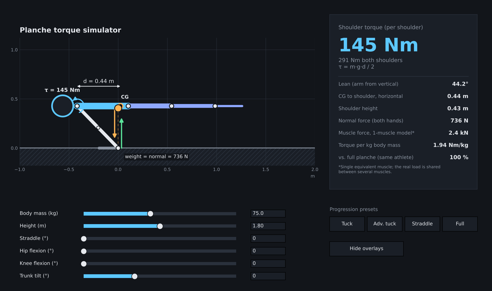
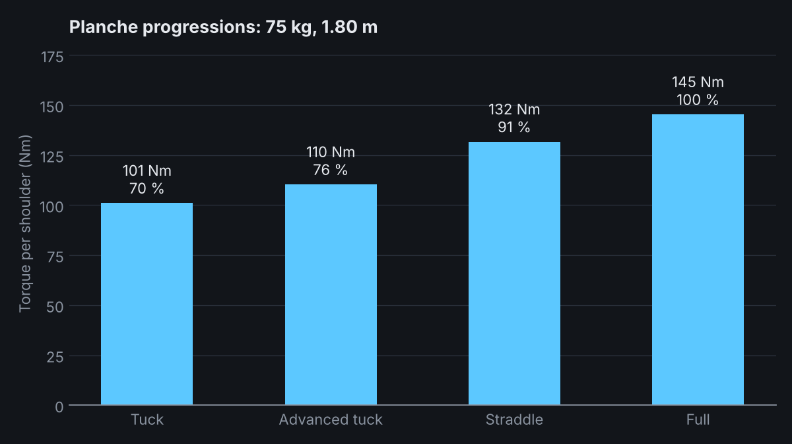

# Planche torque simulator

Interactive simulator of the **joint torque at the shoulder in the planche** (the calisthenics static hold with
the body horizontal and only the hands on the floor). Change body mass, height and leg/hip/knee positions and see
how far the athlete has to lean, where the centre of gravity (CG) sits and how much torque each shoulder has to
produce.



I train calisthenics and wanted to see the physics behind static skills, so this started as a small matplotlib
script. This version separates the model from the interface, fixes several inconsistencies of the first version
(see [History](#history)) and adds tests.

## Quick start

```bash
pip install -r requirements.txt
python -m planche_sim                 # interactive window
python -m planche_sim --lang es       # Spanish interface
python -m planche_sim --preset tuck --weight 80 --height 1.85
python -m planche_sim compare         # table of all progressions
python -m planche_sim compare --plot docs/progressions.png
python -m planche_sim --preset full --save shot.png   # render without a window
python -m unittest discover           # run the tests
```

Needs Python 3.9+ (tested on 3.13), NumPy and matplotlib (3.5+). The model itself (`planche_sim/model.py`) is plain Python with no
dependencies and can be used on its own:

```python
from planche_sim import Pose, solve

r = solve(Pose(weight_kg=75, height_m=1.80))          # full planche
print(r.lean_deg, r.d_cg, r.torque_per_shoulder)       # 44.2  0.44  145.3
```

## Results for a 75 kg, 1.80 m athlete



| Position | Lean (arm from vertical) | CG to shoulder | Torque per shoulder | Relative to full |
|---|---|---|---|---|
| Tuck | 29° | 0.31 m | 101 Nm | 70 % |
| Advanced tuck | 32° | 0.33 m | 110 Nm | 76 % |
| Straddle (90° opening) | 39° | 0.40 m | 132 Nm | 91 % |
| Full | 44° | 0.44 m | 145 Nm | 100 % |

The joint angles of the four progressions are illustrative presets (`PRESETS` in `model.py`), not measurements:
adjust the sliders to match your own photos or video.

## The model

Static, 2D (side view). The origin is the wrist, `x` points towards the feet and `y` up.

* **Body**: head, trunk, thighs, shanks and feet as rigid segments, plus two straight arms. Masses and centres of
  mass come from Dempster's tables as tabulated in Winter, *Biomechanics and Motor Control of Human Movement*;
  segment lengths are fractions of body height (Winter / Drillis & Contini). The feet are pointed, as in a planche.
* **Pose**: the trunk can be tilted (hips above the shoulders is positive), the hips and knees flexed, and the legs
  opened in a straddle. The straddle is modelled as a rotation of the legs about the vertical axis, which shortens
  their horizontal projection by `cos(opening / 2)`.
* **Equilibrium**: with only the hands on the floor, the common CG of body and arms must be exactly above the wrist.
  The lean of the straight arms is therefore not an input but follows from the pose:

  ```
  s = m_body · d / (m_body + (1 − c) · m_arms)      horizontal shoulder-wrist distance
  sin(θ) = s / arm_length                           lean of the arms from the vertical
  ```

  where `d` is the horizontal distance from the shoulder to the CG of the body without arms and `c` is the position
  of the arm's centre of mass along the arm.
* **Shoulder torque**: free-body diagram of the body without arms. The arm exerts a vertical force through the
  shoulder joint, so the shoulder muscles have to balance the weight of the body about that joint:

  ```
  τ_both = m_body · g · d          τ_per_shoulder = τ_both / 2
  ```

  The same value follows independently from the free-body diagram of the arms alone (next section); a test checks
  that both agree.
* **Equivalent muscle force**: `F = τ / (r · sin α)` with the insertion at 43 % of the upper arm and `α = 25°`.
  This is a *single-muscle* illustration: in reality the load is shared between anterior deltoid, pectoralis major,
  coracobrachialis, biceps (long head), serratus and others, so treat the number as a scale, not a prediction.
* **Feasibility checks**: the app warns when the arms could not lean far enough or when any part of the legs would
  go through the floor.

Horizontal distance is what matters: at the same mass, a longer lever (legs straight and together) means more
torque, and tucking the legs, opening them or raising the hips shortens it. Torque scales linearly with body mass
and with height.

## Two equivalent ways to get the shoulder torque

Because the joint is internal, the torque the muscles apply to the arms equals, with opposite sign, the torque they
apply to the trunk (Newton's third law for joint forces and moments). In static equilibrium you can therefore
use whichever segment is easier:

* **Trunk side** (what `solve` reports): `τ = m_body · g · d`, using the CG of the body without arms.
* **Arm side**: the ground pushes up with the whole body weight `N` at the wrist and the arms' own weight acts at
  their centre of mass. Moments about the shoulder, where the joint force has no moment:
  `τ = N · s − m_arms · g · c · s`, with `s = arm_length · sin(lean)`.

Both give the same number (290.6 Nm for both shoulders in the 75 kg / 1.80 m example above). The arm side needs no
trunk or leg model *once the lean is known*, so `torque_from_lean(weight_kg, height_m, lean_deg)` computes it from a
lean measured on a photo or video. The body still matters indirectly: it determines how far the athlete has to lean
for the common CG to sit above the hands, which is what `solve` calculates.

## Limitations

* Side-view model of a symmetric, straight-arm hold: no elbow bend, no scapular protraction or retraction, no
  curvature of the spine.
* The pivot is the wrist. In reality the centre of pressure moves along the hand; in this model that would change
  the lean but not the shoulder torque.
* Average anthropometry. Sensitivity checks: changing the trunk's centre-of-mass fraction between 0.40 and 0.50
  moves the torque by about -3 % to +4 %; moving the head 30 % further forward changes it by about -1 %.
* Static only: no dynamics, no muscle architecture, no fatigue.
* The results are estimates and have **not been validated against force-plate or motion-capture data**. The tests
  check internal consistency (equilibrium, moment balance, scaling), not agreement with experiments. This is a
  learning tool, not training or medical advice.

## Project layout

```
planche_sim/
  model.py     physics: Pose, solve(), presets (no plotting)
  app.py       matplotlib interface (artists are updated, not redrawn)
  cli.py       command line: viewer, compare table, PNG export
  i18n.py      English and Spanish strings
tests/         unittest: model invariants and interface behaviour
docs/          images used in this README
```

## History

The first commit is the original single-file script, kept for reference. The rewrite changes:

* **Consistent leg geometry.** The first version applied the straddle's shortening to the legs' centres of mass but
  not to the knee position or to the drawing, so the figure and the calculation disagreed.
* **Torque per shoulder.** The first version reported the torque of both shoulders as if it were one shoulder.
* **Equilibrium with the arms included.** The first version computed the lean from the CG of the body *without*
  arms, so the CG of body plus arms was about 2 cm behind the wrist and the pose was not in exact equilibrium. That
  overestimated the shoulder torque by about 5 %. The lean is now solved with the common CG.
* **Floor and reach checks**, so impossible poses (legs through the floor) are flagged instead of silently drawn.
* Added trunk tilt, foot length, height-scaled head position, presets, a comparison table and chart, and tests.
* **Interface**: model and interface separated, figure built once and updated in place, sliders and text boxes
  kept in sync in both directions, no forced full redraws while dragging.
